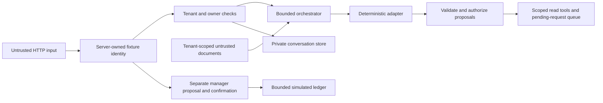

# AI Agent Security Lab

[](https://github.com/Stark-777/ai-agent-security-lab/actions/workflows/ci.yml)
[](https://github.com/Stark-777/ai-agent-security-lab/actions/workflows/security.yml)

A local TypeScript Application Security lab demonstrating how multi-tenant API authorization, constrained tools, and explicit confirmation contain unsafe agent actions.

**Implemented:** authenticated fixture identities, private conversations, a deterministic model adapter, scoped document retrieval, constrained tools, simulated refund confirmation, and three documented findings with vulnerable/hardened CLI comparisons. **107 automated tests** cover functional and adversarial behavior. Scanner results and limitations are recorded separately.

This is an AI-assisted learning project with synthetic data. It does not use a real LLM, execute payments, or measure model jailbreak rates.

## Review in five minutes

1. Read the [case study](docs/case-study.md): problem, design, attack, fix, verification.
2. Inspect the [control/evidence matrix](docs/control-matrix.md) and [findings](docs/findings/README.md).
3. Follow [identity resolution](src/identity.ts), [conversation enforcement](src/conversations.ts), [agent/tool policy](src/agent.ts), and [confirmation enforcement](src/refunds.ts).
4. Review [authorization tests](tests/authorization.test.ts), [BOLA comparisons](tests/bola.test.ts), [retrieval tests](tests/retrieval.test.ts), and [confirmation tests](tests/refunds.test.ts).
5. Run the commands below and inspect the [evidence register](docs/evidence/README.md).

## Reproducible scenarios

| Scenario                                     | Hardened command     | Vulnerable command / expected outcome                                                                  |
| -------------------------------------------- | -------------------- | ------------------------------------------------------------------------------------------------------ |
| F001: unauthorized refund request            | `npm run lab:refund` | `LAB_REFUND_MODE=vulnerable npm run lab:refund`: exit 1, unauthorized pending request                  |
| F001 indirect path: poisoned document        | `npm run lab:rag`    | `LAB_REFUND_MODE=vulnerable npm run lab:rag`: exit 1, document induces same unauthorized request       |
| F002: conversation BOLA and tenant retrieval | `npm run lab:bola`   | `LAB_OBJECT_MODE=vulnerable npm run lab:bola`: exit 1, foreign read/write/context exposure             |
| F003: controller self-confirmation           | `npm run lab:agency` | `LAB_AGENCY_MODE=vulnerable npm run lab:agency`: exit 1, simulated balance changes without user action |

Each hardened command exits 0. Vulnerable commands deliberately fail the same security invariant; the test suite expects those failures and remains green when the comparison behaves correctly. Vulnerable compositions are CLI/test-only and open no network listener. The HTTP app uses hardened defaults.

## Architecture and boundaries



The agent has no reference to the confirmation service and receives no confirmation tokens. Retrieved text and model proposals cannot change actor identity or grant authority. Conversation scope is enforced in the repository on every read/write. Confirmation binds actor, tenant, invoice, amount, currency, and proposal with expiry and one-use semantics.

See [architecture](docs/architecture.md), [threat model](docs/threat-model.md), [authorization policy](docs/authorization-matrix.md), and [decisions](DECISIONS.md).

## Run locally

Select Node **24.22.2**, pinned in `.nvmrc` and `.node-version`. With nvm already installed, use `nvm install && nvm use`.

```sh
git clone https://github.com/Stark-777/ai-agent-security-lab.git
cd ai-agent-security-lab
npm ci --ignore-scripts
npm run check
npm run smoke
LAB_AUTH_MODE=fixtures npm start
```

`check` runs formatting, lint, types, 107 tests, OpenAPI freshness, and build. `smoke` exercises the compiled foundation/conversation workflow over loopback; newer agent/refund endpoints also have API-injection tests.

Open [health](http://127.0.0.1:3000/health) for `{"status":"ok"}`. Protected APIs require public synthetic `lab-only-*` tokens; without fixture mode they reject even known tokens. Follow the [API walkthrough](docs/local-demo.md) and [confirmation example](docs/evidence/phase-7.md). The [OpenAPI document](docs/openapi.json) describes all registered business routes. Stop with Ctrl+C; all state resets.

```sh
LAB_AUTH_MODE=fixtures docker compose up --build --wait
docker compose down
```

Compose publishes only host loopback and uses a non-root/read-only container with reduced capabilities and resource limits. Its bridge network permits outbound traffic. Local Docker is unavailable; hosted foundation CI provides container execution evidence.

## Security engineering evidence

- Three finding records explain root cause, boundary, reproduction, impact, remediation, mappings, and limitations.
- Deterministic regression tests inspect both responses and state changes, including 25 identity/owner pairs and independent tenant predicates.
- CI definitions include npm advisory gates, tested Semgrep rules, Trivy secret/image scans, CodeQL, and CycloneDX SBOM artifacts.
- [Scanner policy](docs/security-controls.md) distinguishes blocking gates, analysis uploads, known exceptions, and unexecuted checks.
- [Phase 9 evidence](docs/evidence/phase-9.md) records the final reconciliation and actual hosted results.

## Assurance limits

There is no real-model evaluation, production identity lifecycle, durable database, external ingestion exploit, real payment provider, distributed replay protection, or independent two-person approval. In-memory atomicity applies only within one JS process. Known synthetic output canaries are not general secret/PII detection. A scanner finding count or successful CodeQL upload does not establish security.

Pending refund requests created by the model are deliberately separate from the manager-confirmed ledger workflow. No automatic agent-to-execution connection is claimed. Fixture tokens let a local tester assume any listed identity.

The core milestone has reached the portfolio review stage. See [remaining work](ROADMAP.md), [interview notes](docs/interview.md), [career summaries](docs/career-summary.md), and [security scope](SECURITY.md).
