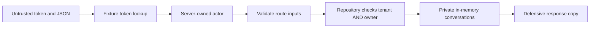
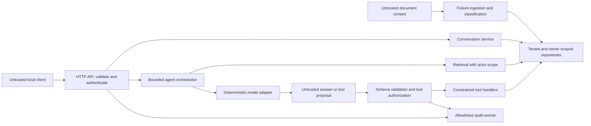

# Proposed architecture and data flow

Phase 8 local addition: separate CI security jobs analyze source, advisory metadata, and built image; SBOM/report artifacts are evidence outputs, not runtime enforcement components. Runtime policy remains tested through the existing suite. See [control policy](security-controls.md).

Phase 7: authenticated manager → exact refund proposal → user review → separate confirmation endpoint → synchronous bounded simulated ledger update. RefundService is not a model tool; agent context never receives its tokens. SHA-256 token digests, process-local replay/rate state, and minimized audit events protect this local workflow. See [limits](evidence/phase-7.md).

Phase 6 local comparison: CLI/test constructor composition can omit conversation tenant/owner checks or retrieval tenant checks. HTTP construction always selects hardened defaults. Authentication and retrieval classification remain active in both modes. [F002](findings/F002-broken-object-authorization.md) documents read/write and model-context consequences.

Phase 5 local flow: trusted fixture manifest → tenant/classification filter → bounded lexical retrieval → source-labeled untrusted model context → validated proposal → independent tool policy. `DocumentRepository` provides context; the default HTTP agent uses clean fixtures. Only CLI/test composition selects poisoning. No new endpoint or external ingestion source is introduced. See [Phase 5](evidence/phase-5.md).

Phase 4: a separate CLI composition swaps only refund-request authorization and opens no listener. `RefundRequestLab` owns a disposable synthetic queue; default HTTP tools remain hardened. Manager requests now create pending entries, capped at 20, and still cannot execute payments. See [F001](findings/F001-broken-tool-authorization.md).

Phase 3 local update: `src/agent.ts` adds the model adapter, orchestrator, constrained registry, tenant-scoped synthetic lookups, and audit decisions. `POST /v1/conversations/:id/agent` authorizes ownership before execution and returns answer/trace without persisting a turn. No RAG ingestion or refund mutation exists. The earlier implementation descriptions below are historical Phase 2 context; see [Phase 3](evidence/phase-3.md) for current guarantees.

Target design with Phases 1–2 implemented: HTTP foundation, local fixture authentication, server-derived actor context, and a tenant/owner-scoped conversation repository. Agent, tools, retrieval, customer/document repositories, and action audit trails below remain unimplemented.

## Implemented foundation

`src/server.ts` owns configuration, loopback listening, and signal shutdown; `src/app.ts` builds the testable Fastify instance without opening a socket. `src/config.ts` validates environment settings. `src/validation.ts` rejects invalid runtime input without including values in errors. `src/contracts.ts` supplies shared response schemas for serialization and OpenAPI. `src/logger.ts` supplies JSON logging with credential redaction and raw-object omission.

`GET /health` remains public. The encapsulated plugin in `src/conversation-routes.ts` authenticates protected routes in `onRequest`, before body parsing; the public route does not inherit that hook. `src/identity.ts` maps a single opaque fixture token to an immutable actor. `src/conversations.ts` owns a per-application private map and enforces actor tenant AND owner on every read/append. Creation derives scope from the actor, never from the request body. Repository results are copies, so consumers cannot bypass write checks by modifying references.

Limits remain 8 KiB request bodies and 10-second request/connection timeouts, with additional local storage capacities. Request-completion logs are operational events, not a finished security audit trail. Restarting the process clears conversations; this repository provides no durable, distributed, or database-level guarantees.



## Components

One API process contains authentication, request validation, authorization policy, agent orchestration, model adapter, tool registry, scoped data repositories, and an audit logger. The deterministic adapter is a separate interface, not a separate service. Document ingestion initially loads reviewed local fixture files; an adversarial fixture supplies the later poisoned article. Retrieval is simple lexical matching over a tiny collection, not a vector database.



## Data-flow and trust boundaries

```mermaid
sequenceDiagram
  participant U as Client
  participant A as API/authentication
  participant O as Orchestrator
  participant R as Scoped repository
  participant M as Model adapter
  participant T as Tool enforcement
  U->>A: Token, message, optional object identifiers (untrusted)
  A->>O: Validated request + server-derived actor context
  O->>R: Retrieve using actor tenant and allowed classification
  R-->>O: Authorized but untrusted document text
  O->>M: Bounded, filtered context with source labels
  M-->>O: Untrusted answer or tool proposal
  O->>T: Proposal + original actor context
  T->>T: Validate schema, authorize role and action
  T->>R: Scoped lookup/mutation; verify object rules
  R-->>T: Allowed result or denial
  T-->>O: Minimized tool result; record audit decision
  O-->>A: Validated/minimized response
  A-->>U: Answer or structured error
```

The later refund flow must additionally require application-issued confirmation before the mutation. The model and retrieved documents cannot create that confirmation. A fresh policy check occurs at execution, not just when the proposal is created.

| Boundary/component        | Trust treatment                                                                       | Enforcement responsibility                                                       |
| ------------------------- | ------------------------------------------------------------------------------------- | -------------------------------------------------------------------------------- |
| Client to HTTP API        | All messages, identifiers, and headers untrusted                                      | Validate shape/size; authenticate local token; derive actor server-side          |
| Authentication and policy | Trusted enforcement code, subject to bugs                                             | Fail closed; never accept client/model role or tenant overrides                  |
| Fixture metadata/content  | Loader is trusted for assigned tenant/classification; document text remains untrusted | Metadata comes from fixture manifest, not embedded text; test ingestion mistakes |
| Repository to context     | Authorized data can still contain malicious instructions                              | Filter scope/classification before model invocation; preserve provenance         |
| Model to tool execution   | Output, tool names, arguments, and answers untrusted                                  | Validate, allowlist, authorize, constrain effects; reject unknown tools          |
| Tool to data store        | Tool is privileged but cannot bypass object checks                                    | Repository requires actor scope; verifies tenant and ownership on each operation |
| App to logs/response      | Any raw text may contain secrets or personal data                                     | Allowlist audit fields; redact credentials; minimize response data               |

Trusted means relied upon for enforcement, not proven secure. Retrieved text is partially trusted for factual usefulness only and has zero authority to change policy.

## Proposed API surface

- `GET /health`: public minimal health result, no configuration details.
- `GET /v1/me`: authenticated caller identity, excluding its token.
- `POST /v1/conversations`: create a conversation owned by the authenticated user.
- `POST /v1/conversations/:id/messages`: owner-only user-message storage now; assistant interaction later.
- `GET /v1/conversations/:id`: owner-only history.
- Later, `POST /v1/refund-proposals/:id/confirm`: authenticated billing-manager confirmation bound to the exact proposal.

Tools are internal functions, not independent unauthenticated HTTP endpoints. The API never exposes a general-purpose arbitrary tool execution route. The exact request schemas and error contracts will be designed in their implementation phase.

## Bounded execution

Proposed initial budget: 8 KiB user messages, three retrieved documents, 16 KiB total retrieved text, and at most three tool proposals per message. Limit violations fail explicitly; no infinite model/tool loop. These provisional limits constrain resource use, not prompt injection. No shell, arbitrary URL fetcher, filesystem browsing, or external connector tool is planned.
